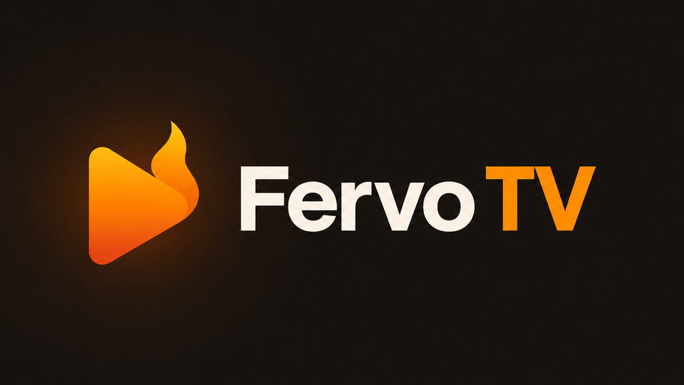
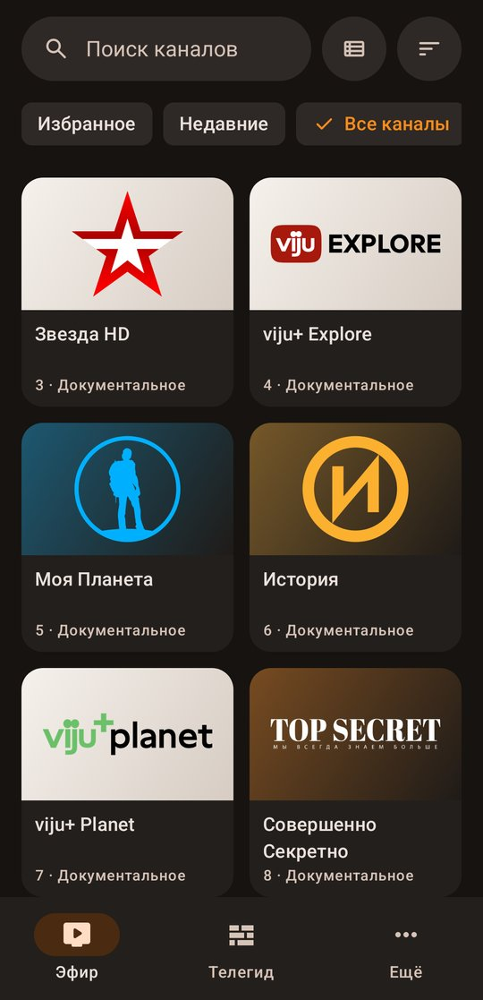
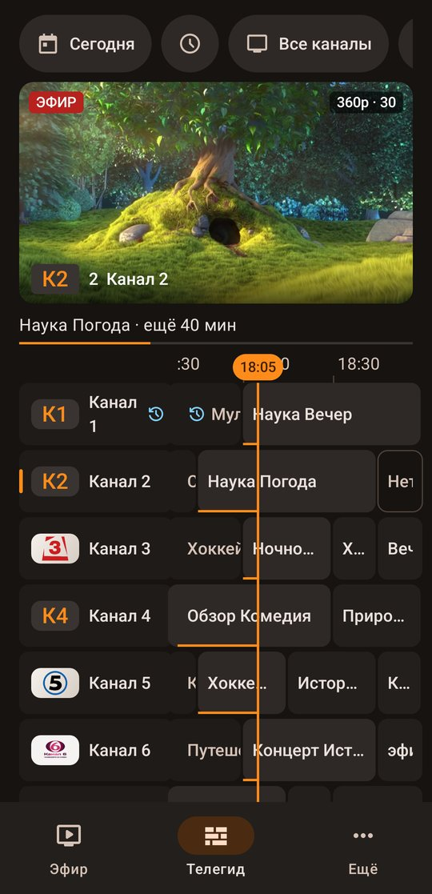
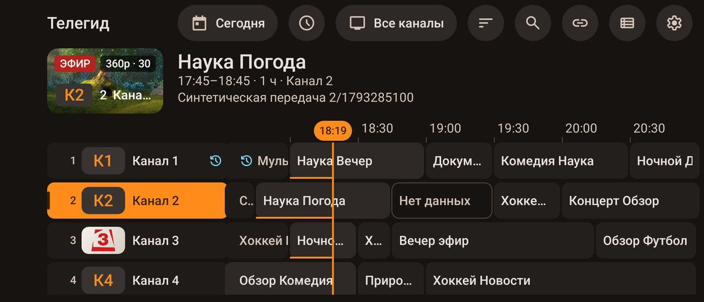
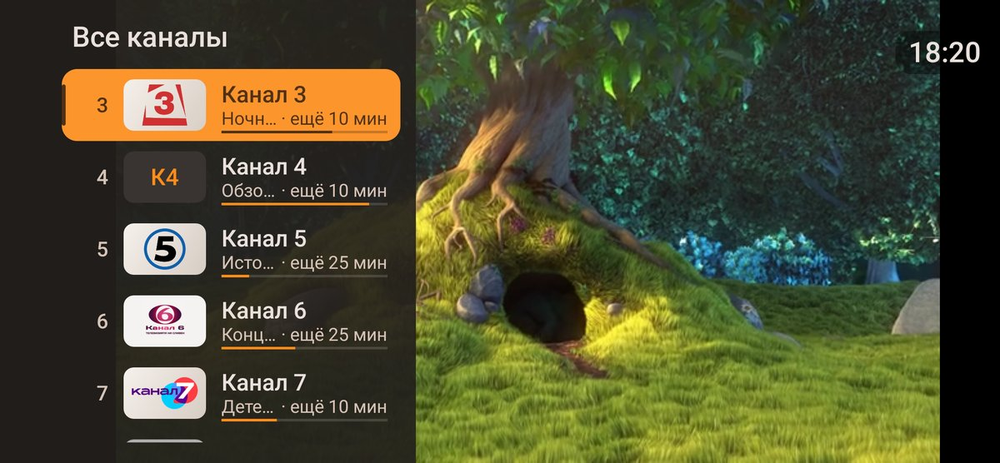

<p align="center"></p>

# Fervo TV

[](https://github.com/Divarion-D/FervoTV/actions/workflows/ci.yml)


**IPTV-плеер для Android, который одинаково удобен с пультом на диване и с телефоном в руке.**

Добавьте ссылку на плейлист или аккаунт Xtream Codes — и через несколько секунд у вас каналы с логотипами,
программа передач и предпросмотр прямо в списке. Один APK весит около 2,4 МБ и работает на телефонах,
планшетах, Android TV и приставках.

<p align="center">
  
  &nbsp;
  
</p>
<p align="center">
  
</p>

## Что умеет

**Смотреть, а не настраивать.** M3U/M3U8 по ссылке или из файла, Xtream Codes — и всё. Потоки HLS, MPEG-TS и MP4.
Плейлист сохраняется на устройстве: в следующий раз каналы открываются сразу, даже без интернета,
а обновляются в фоне по расписанию, которое вы выберете.

**Эфир.** Наведите на канал — он начнёт играть в окне рядом со списком. Ещё одно нажатие — и он во весь экран,
без перезапуска потока. Каналы плитками или списком, с текущей передачей и полоской «сколько осталось».
Переключение цифрами, как на обычном телевизоре, и кнопка «предыдущий канал».

**Телегид.** Программа передач из XMLTV: адрес берётся из плейлиста, каналы сопоставляются автоматически.
Сетка с линией «сейчас», выбор дня, поиск по передачам.

**Ваш порядок.** Избранное, скрытые каналы и категории, свои названия, сортировка, собственные подборки.
В «Недавних» — только то, что вы действительно смотрели хотя бы минуту. Всё это переживает обновление плейлиста.

**Во весь экран.** ◀ или свайп от левого края — список каналов поверх видео, ▶ или свайп справа — недавние.
Не нужно выходить из плеера, чтобы найти другой канал.

<p align="center">
  
</p>

**Логотипы сами находятся.** Если в плейлисте логотипа нет или он не открывается, Fervo TV ищет его по названию
в базе [iptv-org](https://github.com/iptv-org/api) и подбирает подложку под цвета логотипа.

**Переезд за минуту.** Сохраните настройки в файл — источник, телегид, избранное и все правки каналов —
и загрузите его на новом устройстве или после переустановки.

**Пульт и пальцы на равных.** На TV — боковое меню, подсказки кнопок и часы, на телефоне — нижнее меню и жесты.
Повернули телефон — список и видео встают рядом. Интерфейс на русском и английском.

## Что дальше

Fervo TV развивается по фазам. Сейчас готовы P0 и P1, идёт P2.

| Фаза | Что появится |
|---|---|
| ✅ P0 | Фундамент: база данных на 50 000+ каналов, потоковый разбор плейлистов, движок плеера |
| ✅ P1 | Эфир с предпросмотром, телегид, избранное и подборки, файл настроек, русский и английский |
| 🚧 P2 | Фильмы и сериалы, главная с «продолжить просмотр», общий поиск, история, новые настройки |
| P3 | Плеер: звуковые дорожки, субтитры, картинка в картинке, DRM |
| P4 | Несколько источников, Stalker, архив передач, напоминания |
| P5 | Профили и PIN, резервные копии, запись, загрузки, несколько каналов на одном экране |
| P6 | Описания и постеры, спорт, темы оформления, настройка с телефона по QR-коду, обновления |

Подробно — в [спецификации](docs/spec/00-overview.md) и [плане по фазам](docs/spec/90-roadmap.md).
У каждой функции там есть строка «Статус»: ✅ есть · 🟡 частично · ⬜ нет.

## Установка

Готовых сборок пока нет — APK собирается из исходников за пару минут (см. [Сборка](#сборка)).

1. Включите на устройстве отладку: «Настройки → О телефоне», 7 раз нажмите «Номер сборки», затем
   «Для разработчиков → Отладка по USB». На Android TV — «Настройки → Об устройстве → Сборка»
   и «Отладка по сети»; подключение — `adb connect <ip-приставки>:5555`.
2. Подключите устройство и выполните `make install run`.
3. При первом запуске выберите **M3U / M3U8** (ссылка или «Выбрать файл») или **Xtream Codes**
   (сервер вида `http://host:port`, логин и пароль) и нажмите «Загрузить».

Хотите просто попробовать? Подойдёт открытый плейлист iptv-org: `https://iptv-org.github.io/iptv/index.m3u`.

## Управление

В полноэкранном режиме:

| Что сделать | Пульт / клавиатура | Сенсор |
|---|---|---|
| Следующий / предыдущий канал | ▲ ▼, CH+ CH−, PageUp PageDown, ⏭ ⏮ | свайп вверх / вниз |
| Канал по номеру | цифры, затем OK или подождать 2 с | — |
| Вернуться к предыдущему каналу | Last / Recall | — |
| Список каналов поверх видео | ◀ | свайп от левого края |
| Недавние каналы | ▶ | свайп от правого края |
| Информация о канале | OK, Menu, Info, Guide | тап |
| Пауза | Play/Pause, пробел | — |
| Назад к списку | Back | жест «назад» |

Каналы переключаются по кругу внутри текущего списка. Чтобы выйти из приложения, нажмите «Назад» на главном экране два раза.

## Сборка

Нужны JDK 17 и Android SDK (platform 35, build-tools 35). Gradle ставить не надо — в проекте есть wrapper.
Удобнее всего через `make` (без аргументов покажет все цели):

```bash
make check        # то же, что CI на каждый коммит: тесты + lint + debug-сборка
make test         # все unit-тесты;  make test-fast — только ядро
make release      # один подписанный универсальный APK для TV, телефона и планшета → dist/
make release-mobile  # отдельный APK устаревшего мобильного интерфейса → dist/
make install run  # собрать release, поставить по adb и запустить (данные сохраняются)
make install-debug run-debug  # debug — отдельным приложением «Fervo TV debug» рядом с release
make dist         # подписанные dist/FervoTV-<версия>.apk и .aab + проверка подписи
make ci-release   # как release.yml: тесты и lint release, затем dist
```

JDK и SDK по умолчанию ищутся в `~/.local/share/jdk-17` и `~/Android/Sdk`; другие пути задаются через
`JAVA_HOME` и `ANDROID_HOME`.

<details>
<summary>То же самое через Gradle</summary>

```bash
export JAVA_HOME=~/.local/share/jdk-17     # или системный JDK 17+
export ANDROID_HOME=~/Android/Sdk
echo "sdk.dir=$ANDROID_HOME" > local.properties   # один раз

./gradlew testDebugUnitTest lintDebug   # то же, что CI на каждый коммит
./gradlew :app-tv:assembleDebug         # app-tv/build/outputs/apk/debug/app-tv-debug.apk (~16 МБ)
./gradlew :app-tv:assembleRelease       # app-tv/build/outputs/apk/release/app-tv-release.apk (~3 МБ, R8)
./gradlew :app-tv:bundleRelease         # app-tv/build/outputs/bundle/release/app-tv-release.aab — для Google Play
```

Без ключа подписи получится `app-tv-release-unsigned.apk`.
</details>

### Один APK и архитектуры

`make release` по умолчанию собирает только выпускаемый модуль `app-tv` и намеренно кладёт в `dist/` **один
универсальный APK** `FervoTV-<версия>.apk`. Это не неполная сборка: разбиение APK по ABI не включено.
Внутри этого APK есть нативные библиотеки для `arm64-v8a`, `armeabi-v7a`, `x86` и `x86_64`; поэтому он
подходит для 32- и 64-битных ARM-устройств, а также для x86-эмуляторов и устройств. Минимальная версия
Android — 5.0 (API 21). Для магазина используется `make bundle`, который создаёт один `.aab`.

**О скорости судите по release-сборке.** Debug-сборка Compose идёт без оптимизаций и в разы медленнее:
на TECNO CH6i запуск занимает 1,4–1,9 с против 0,6–0,7 с, логотипы появляются через 1,5–2,3 с против 0,35–0,4 с.
Debug ставится отдельным приложением со своими данными, так что плейлист в нём придётся указать заново.

### Как устроен проект

- `core` — всё, что не интерфейс: модели, разбор M3U и XMLTV, Xtream, база данных, логотипы, плеер, команды ввода.
  Все значения по умолчанию собраны в одном файле — [`Defaults.kt`](core/src/main/java/app/iptvplayer/core/Defaults.kt).
- `app-tv` — приложение, которое выпускается: одно и то же для TV, телефонов и планшетов, раскладка подстраивается под экран.
- `app-mobile` — прежний интерфейс; не выпускается.

Подробнее — в [docs/ARCHITECTURE.md](docs/ARCHITECTURE.md), облик и компоненты — в
[дизайн-системе](docs/spec/33-design.md) и [макете](docs/design/mockup.html) (открыть в браузере).

<details>
<summary>Выпуск новой версии</summary>

1. В корневом `build.gradle.kts` увеличить `versionCode` на 1 и поменять `versionName` в формате `major.minor.patch` (например, `0.2.0`).
2. В `core/src/main/assets/CHANGELOG.md` добавить сверху раздел `## 0.2.0 — ДД.ММ.ГГГГ` со строками `- …`.
   Этот файл показывается в приложении («Что нового») и становится описанием релиза на GitHub.
3. Обновить строки «Статус» в [`docs/spec/`](docs/spec/), закоммитить, запушить и поставить тег:
   ```bash
   git tag v0.2.0 && git push origin v0.2.0
   ```
   GitHub Actions (`release.yml`) проверит, что тег совпадает с `versionName`, прогонит тесты и lint, соберёт
   подписанные `FervoTV-0.2.0.apk` и `FervoTV-0.2.0.aab` и создаст GitHub Release.

</details>

<details>
<summary>Ключ подписи</summary>

- Ключ и пароли лежат в папке `signing/` проекта: `fervotv-release.jks` (alias `fervotv`) и `signing.properties`
  (`keystore`, `keystorePassword`, `keyAlias`, `keyPassword`). Папка в `.gitignore` и в репозиторий не попадает;
  на новой машине её нужно перенести вручную. Свойства Gradle `fervo.*` по-прежнему работают и имеют приоритет.
- На CI те же значения лежат в секретах репозитория: `FERVO_KEYSTORE_BASE64` (файл .jks в base64),
  `FERVO_KEYSTORE_PASSWORD`, `FERVO_KEY_ALIAS`, `FERVO_KEY_PASSWORD`.
- **Сделайте резервную копию ключа и паролей**, например в менеджере паролей. Без ключа обновление
  не встанет поверх установленного приложения — только удаление и установка заново.
- Отпечаток сертификата (SHA-256): `A6:5F:7A:24:25:FA:8F:9F:83:0C:4D:AE:CC:DD:6A:C7:DB:A7:39:C9:5B:19:7A:5F:20:35:B5:DB:62:EA:D0:A2`.

</details>

## Стек

| Что | Чем | Версия |
|---|---|---|
| Язык | Kotlin, корутины | 2.1 · 1.8 |
| Интерфейс | Jetpack Compose, Material 3 | BOM 2024.12 |
| Плеер | Media3 ExoPlayer с HLS | 1.5 |
| Картинки | Coil | 2.7 |
| Данные | Room (SQLite, полнотекстовый поиск FTS4), Paging | 2.6 · 3.3 |
| QR-коды | ZXing core | 3.5 |
| Сеть и JSON | средства платформы, без сторонних библиотек | — |
| Тесты | JUnit 4, Robolectric | 4.13 · 4.14 |
| Сборка | Gradle, Android Gradle Plugin, KSP | AGP 8.7 |
| Android | minSdk 21 (Android 5.0), targetSdk 35 | — |

Журнал изменений — [CHANGELOG.md](core/src/main/assets/CHANGELOG.md).
